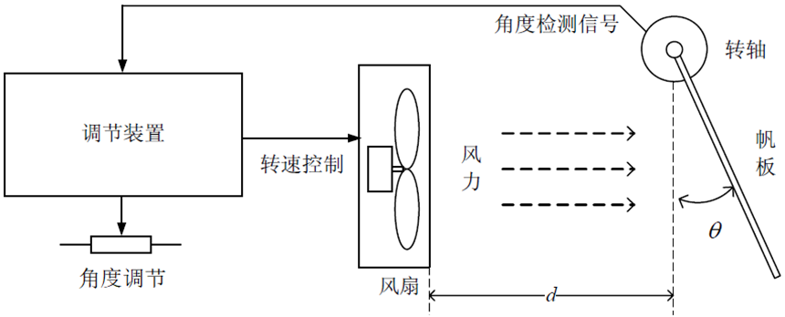
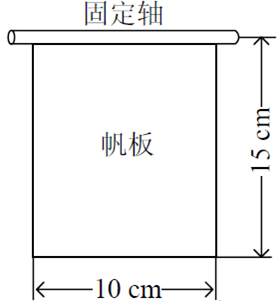

# 帆板控制系统（控制组招新题）

> 本文件由原始 docx 自动提取，正文逐字保留。
> 原始文件：`控制方向-帆板控制系统设计与制作.docx`（同目录）
> 配图：`fig1_系统示意.png`、`fig2_帆板尺寸.png`

---

## 硬性要求（不符合不予测评）

- **必须采用纯模拟电路的方法来实现。**
- **作品必须在机械结构上安装成1个整体，不得存在机械结构分离。**
- **测评开始后，作品先进行0.2m自由落体，测试作品可靠性。作品不得有额外包裹物，自由落体测试后不得调试、不得修复。**
- **不符合上述要求的作品，不予测评。**

## 任务

设计并制作一个帆板控制系统，通过对风扇转速的控制，调节风力大小，来改变帆板转角θ，如图所示。θ由图中的“角度调节”电位器设定。

## 要求

### 1. 基本要求（70分）
- 1）当间距d=15cm时，调节电位器，能够使帆板转角θ在10~60° 范围内变化。
- 2）当间距d=15cm时，调节电位器，能够使帆板转角θ稳定在45°±5°范围内。
### 2. 发挥部分（30分）
- 1）间距d在10~25cm范围内任意选择，帆板转角θ依然能稳定在45°±5°范围内。要求间距d变化后，5秒内θ能稳定在45°±5°范围内。
- 3）其它（焊接、机械结构 等）。

## 四、说明

1.	调速装置自制，不得使用单片机，整个电路必须在洞洞板上焊接。电源可采用外置电源直接供电（如台式电源、电池、开关电源等），调速装置中不必包含电源。

2.	必须在转轴处安装量角器，以便观察帆板转角读数。

3.	风扇选用台式计算机散热风扇或其他形式的直流供电轴流风扇，可以使用电机专用控制驱动芯片或模块进行功率驱动，但不能选用带有自动调速功能的风扇、芯片或模块。

4.	帆板的材料和厚度自定，帆板安装在固定轴上，固定轴相应足够灵活转动，不阻碍帆板运动。帆板形式及具体制作尺寸如下图所示。

---

## 整理时标注的疑点（非原文，供与负责人核对）

| # | 疑点 | 影响 |
|---|---|---|
| 1 | 「纯模拟」的边界：NE555、比较器、门电路、稳压模块是否允许 | 直接决定方案难度差一档 |
| 2 | 发挥部分编号只有 1)、3)，缺 2) | 疑似漏写一条要求 |
| 3 | 0.2m 自由落体落在什么面、落几次 | 决定加固强度 |
| 4 | d 的测量基准；变 d 时移动风扇还是帆板 | 决定走线与支架设计 |
| 5 | 基本要求 2) 的「稳定 45°±5°」是否有时限 | 原题为 10 秒 |
| 6 | 「不得有额外包裹物」是否允许内部减震 | 决定结构方案 |
| 7 | 量角器自带还是统一提供 | — |
| 8 | 现场允许几路电源、电压上限 | ±12V 方案能否成立 |
